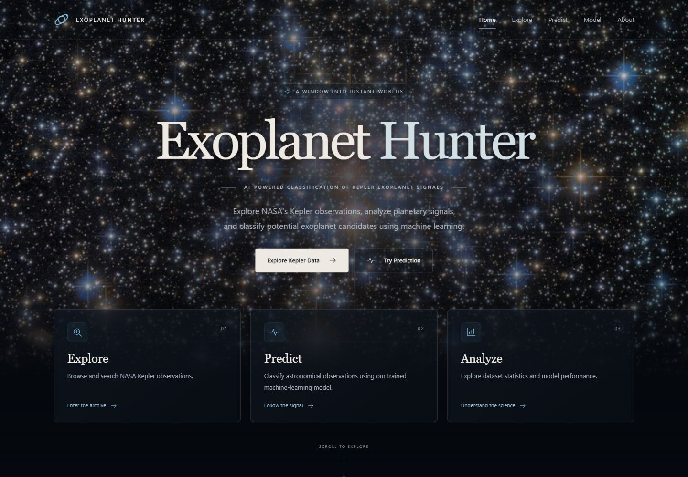
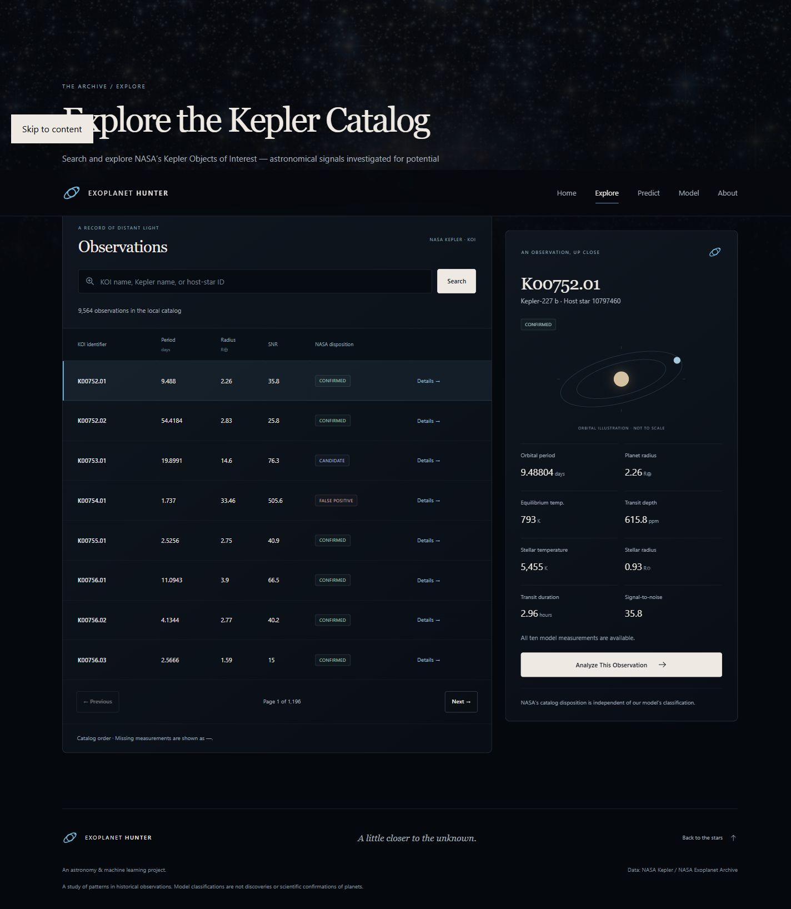
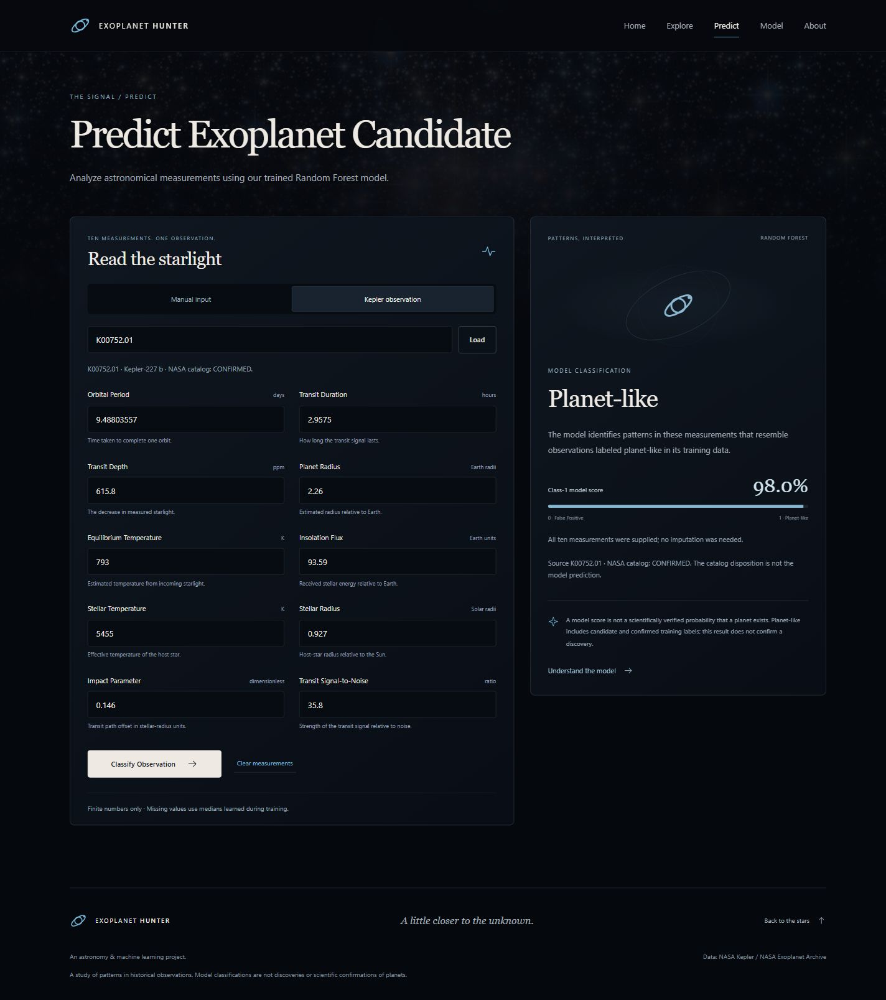
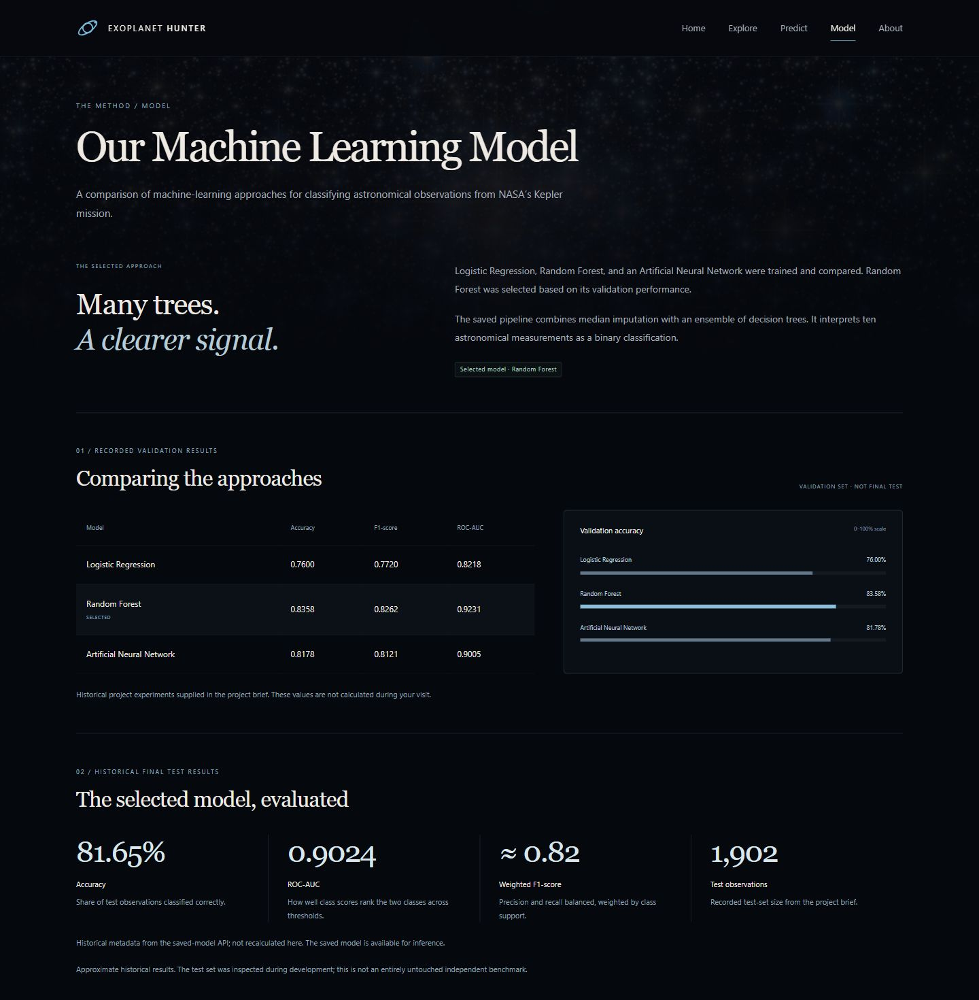

# Exoplanet Hunter

## Project overview

Exoplanet Hunter is a college machine learning project that uses NASA Kepler observations to classify signals as Planet-like or False Positive. A Flask website lets users browse the catalog, inspect measurements, and run the saved Random Forest model.

## Features

- Astronomy-themed homepage with a starfield background and scroll effects.
- Searchable Kepler catalog with pagination and observation details.
- Prediction from manually entered measurements or a selected catalog record.
- Model comparison, recorded performance, and explanations of the input features.
- Five frontend pages and a Flask JSON API with input validation and error handling.

## Screenshots

These captures show the running application with real catalog records and model output.

| Home | Explore |
|---|---|
|  |  |

| Predict | Model |
|---|---|
|  |  |

[About page](preview/about-desktop.jpg) and [mobile screenshots](FRONTEND.md#screenshots) are also available.

## Dataset

The local copy of the [Kepler Objects of Interest catalog](https://exoplanetarchive.ipac.caltech.edu/cgi-bin/TblView/nph-tblView?app=ExoTbls&config=cumulative) comes from NASA and the NASA Exoplanet Archive. Its header records an export date of 16 October 2026.

| File | Rows | Columns | Purpose |
|---|---:|---:|---|
| `data/kepler_raw.csv` | 9,564 | 49 | Catalog identifiers, measurements, and NASA dispositions |
| `data/model_data.csv` | 9,564 | 13 | Ten model features, host identifier, disposition, and binary target |

The catalog contains 8,214 distinct host stars: 2,748 observations are Confirmed, 1,977 are Candidate, and 4,839 are False Positive. A star can have several observations. The training target combines Confirmed and Candidate into class 1 (Planet-like); False Positive is class 0.

The ten inputs are orbital period, transit duration, transit depth, planet radius, equilibrium temperature, insolation flux, stellar temperature, stellar radius, impact parameter, and transit signal-to-noise ratio. Units and field names are listed in [the API documentation](BACKEND_API.md#predict). Missing measurements are retained in the datasets and handled by the saved imputer during prediction.

Both datasets and the trained model are included, so running the website does not require a data download or retraining.

## Machine learning

I trained and compared Logistic Regression, Random Forest, and an Artificial Neural Network (ANN). The notebook groups observations by host star when splitting the data, so observations from one host do not cross the training, validation, and test partitions.

### Validation results

The comparison used 6,158 training observations and 1,504 validation observations. Random Forest was selected based on these validation results.

| Model | Accuracy | F1-score | ROC-AUC |
|---|---:|---:|---:|
| Logistic Regression | 0.7600 | 0.7720 | 0.8218 |
| Random Forest | 0.8358 | 0.8262 | 0.9231 |
| ANN | 0.8178 | 0.8121 | 0.9005 |

The F1-score above is for the Planet-like class. ROC-AUC measures how well model scores separate the two classes across classification thresholds.

### Final Random Forest test results

The final pipeline uses median imputation and 100 decision trees, trained on all 7,662 observations in the original training partition.

| Metric | Result |
|---|---:|
| Accuracy | 81.65% |
| ROC-AUC | 0.9024 |
| Weighted F1-score | Approximately 0.82 |
| Test samples | 1,902 |

These are recorded results from `notebooks/02_model_training.ipynb`, not metrics calculated when the website loads. The test set was inspected during earlier development, so it is not an untouched independent benchmark. The comparison pipelines used mean imputation and scaling; the exported Random Forest uses median imputation without scaling.

## Technology stack

- Application: Python, Flask, Pandas, NumPy, Scikit-learn, and Joblib.
- Frontend: HTML templates, CSS, and vanilla JavaScript.
- Notebook experiments: TensorFlow/Keras, Matplotlib, and Seaborn, alongside the scientific Python libraries above.

TensorFlow is used for the ANN experiment. It is not needed to run the website, which serves only the saved Random Forest pipeline.

## Installation

The application has been tested with Python 3.13.5. Install Git and Python first. While this repository is private, cloning requires access through an authenticated GitHub account.

Clone the repository:

```sh
git clone https://github.com/msthakkr2006-glitch/exoplanet-hunter.git
cd exoplanet-hunter
```

On Windows PowerShell, create an environment, install the runtime dependencies, and start Flask:

```powershell
python -m venv .venv
.\.venv\Scripts\python.exe -m pip install -r requirements.txt
.\.venv\Scripts\python.exe app.py
```

On macOS or Linux, use the environment's `bin/python` instead:

```sh
python3 -m venv .venv
.venv/bin/python -m pip install -r requirements.txt
.venv/bin/python app.py
```

Open [http://127.0.0.1:5000](http://127.0.0.1:5000) in your browser. Stop the server with Ctrl+C. No API key, `.env` file, frontend build, or model training is needed. Keep the pinned runtime versions for compatibility with the saved model.

The notebooks are preserved experiment records, not required setup steps. They contain original Windows file paths, an installation cell, and cells that overwrite the dataset or model when executed. To work on them, use a separate copy and install a notebook environment plus TensorFlow/Keras, Matplotlib, and Seaborn. Do not run all cells just to start the website.

## Tests

Using the Windows environment above:

```powershell
.\.venv\Scripts\python.exe -W error -m unittest discover -s tests -v
.\.venv\Scripts\python.exe -m pip check
```

Use `.venv/bin/python` on macOS or Linux. The suite contains 43 tests covering API validation, real model predictions, catalog search, page routes, and preservation of protected files. It does not retrain the model.

## Project structure

```text
exoplanet-hunter/
  app.py                       Flask app and API routes
  backend.py                   Catalog access and model inference
  frontend.py                  Frontend page routes
  data/                        Raw and prepared Kepler CSVs
  models/exoplanet_rf.joblib    Saved imputer and Random Forest pipeline
  notebooks/                   EDA and training experiments
  preprocesing/pre_game.py      Early dataset inspection script
  templates/                   Five pages and shared templates
  static/                      CSS, JavaScript, and images
  tests/                       Backend and frontend integration tests
  preview/                     Selected application screenshots
  requirements.txt             Pinned runtime dependencies
  BACKEND_API.md                API reference
  FRONTEND.md                   Frontend structure and behavior
```

## Documentation

- [Backend API](BACKEND_API.md): endpoints, feature units, validation, and examples.
- [Frontend](FRONTEND.md): pages, API integration, responsive behavior, and screenshots.

## Limitations

- The model classifies historical Kepler observations. It does not independently discover or confirm planets.
- A class-1 model score is not a scientifically verified probability that a planet exists. Candidate and Confirmed labels share the same training class.
- Historical test results may not reflect performance on new observations, and the test set was inspected during development.
- The included server is for local development. The application does not provide user accounts or a production deployment setup.
- This publishing copy replaces 12 local user-folder paths in a TensorFlow installation log with `<python-site-packages>`. Notebook code, charts, results, and other outputs are preserved. Original project notebooks are unchanged. Fixed project paths in notebook code still need adjustment when working in a separate copy.

## Developer

Developer profile, photo, and contact links will be added here.

## Credits

Data: NASA Kepler and the [NASA Exoplanet Archive](https://exoplanetarchive.ipac.caltech.edu/). The archive is operated by Caltech for NASA's Exoplanet Exploration Program. Its [FAQ](https://exoplanetarchive.ipac.caltech.edu/docs/faq.html) permits further research with appropriate acknowledgements; see its [acknowledgement and citation guidance](https://exoplanetarchive.ipac.caltech.edu/docs/acknowledge.html), including Christiansen et al. (2025).

The starfield photograph was supplied with the project. Its original creator and reuse rights are still unverified; no NASA or ESA license is assumed. This copy is prepared for a private repository only. Do not make the repository public, publish its screenshots, or deploy the website publicly until the image rights and required credit are confirmed. Private visibility does not establish reuse permission.

The image is retained unchanged because the homepage, interior pages, and asset tests depend on it. Removing it would change the approved design and fail the asset tests. The screenshots also reproduce the photograph. Planet silhouettes and orbital diagrams are illustrations. No NASA affiliation or endorsement is implied.
